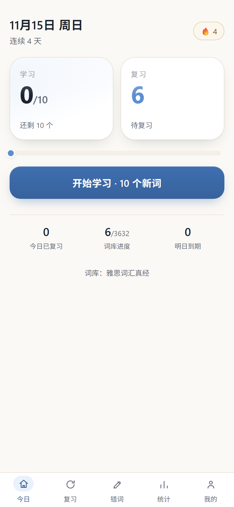
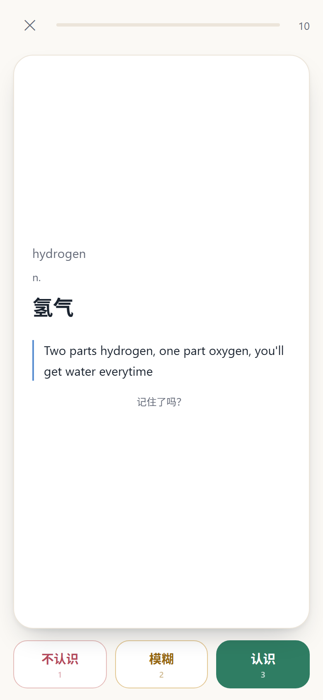
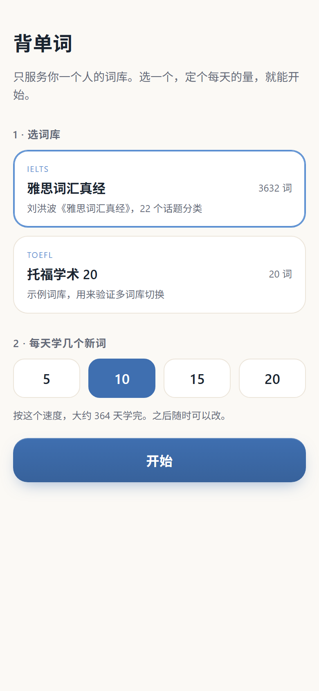
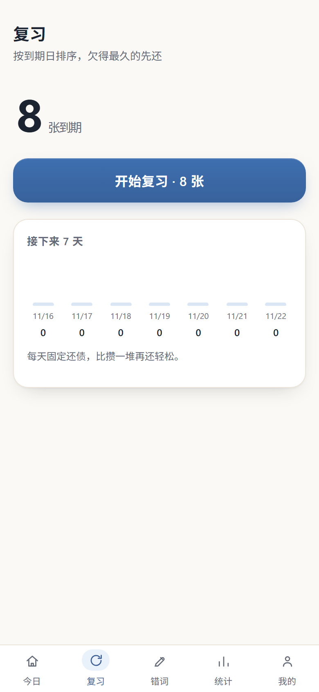
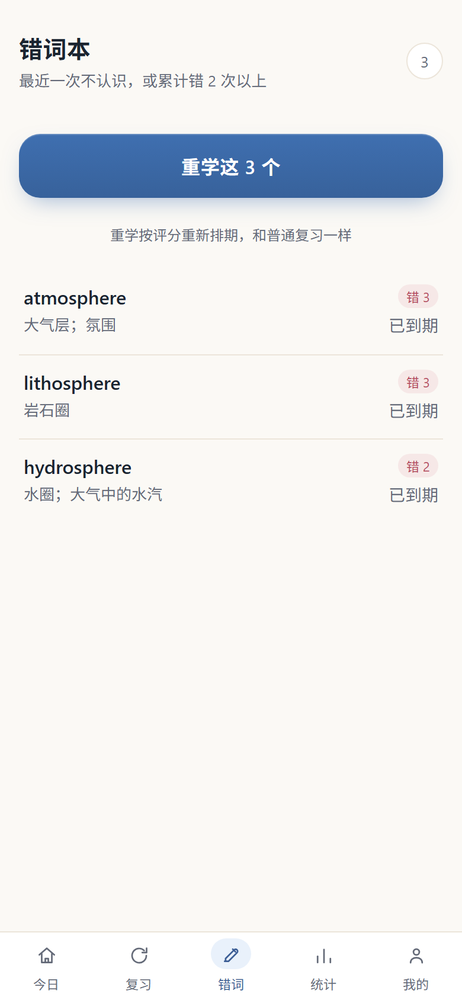
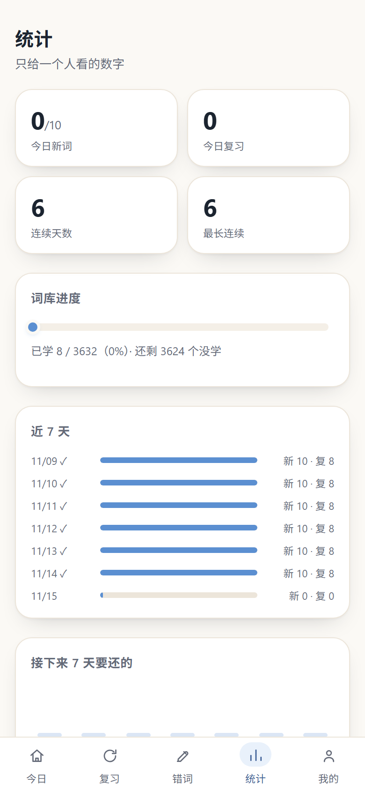
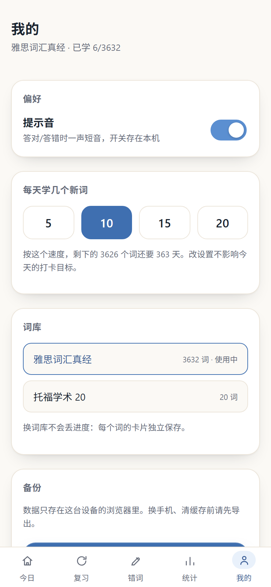

# 背单词（word-drill）

只服务一个人的背单词网页：雅思词汇真经 3632 词，本地存储，零依赖、零构建、零后端。
移动端优先，目标是加到 iPhone 主屏、每天点开就能学。

**线上地址：<https://jaylenxuan.github.io/word-drill/>**（GitHub Pages，推 main 自动重建）

| 首页 | 卡片 | 完成页 | 首次引导 |
|---|---|---|---|
|  |  |  |  |

| 复习 | 错词本 | 统计 | 设置 |
|---|---|---|---|
|  |  |  |  |

（截图是 390×844 移动端视口，浅色主题；深色主题自动跟随系统。）

---

## 快速开始

> ⚠️ **不要双击 `index.html`**。用了 ES Module，`file://` 会被浏览器按跨域拦掉，必须走本地服务器。

在 `word-drill` 目录下：

```bash
python -m http.server 5173
```

然后浏览器打开 <http://127.0.0.1:5173>。
手机同 Wi-Fi 调试时用电脑内网 IP 访问（如 `http://192.168.1.8:5173`）。

首次进入会让你选词库、定每天的新词数，之后每天打开就是「学习 / 复习」两张卡。

## 装到 iPhone 主屏

现在支持主屏安装（`manifest.webmanifest` + `apple-touch-icon`），但**必须通过网址访问**，
`file://` 不行。两种做法，选一个：

**A. 电脑起服务 + 手机同 Wi-Fi（最快）**

```bash
python -m http.server 5173
```

手机浏览器打开 `http://<电脑内网IP>:5173` → 分享 → 添加到主屏幕。
缺点：电脑关机或不在同一网络时打不开。

**B. 推到静态托管（推荐日常用）**

把整个目录推到 GitHub Pages / Cloudflare Pages / Netlify 之类的静态托管，拿到 HTTPS 网址后
在 iPhone Safari 打开 → 分享 → 添加到主屏幕。手机随时可用，不再依赖电脑。
托管的是代码，**学习数据仍然只存在你手机浏览器里**，不上传。

> 主屏图标用的是 `assets/whale/icons/apple-touch-icon-180.png`（180×180）。
> 若图标边缘被裁或底色不对，是 iOS 的遮罩行为，改 `tools/make-icons.py` 里的留白比例重生成即可。

## 每天被叫来（iOS 快捷指令）

网页本身做不到定时推送（那需要服务器），用系统自带的能力：

1. 打开「快捷指令」→ 自动化 → 新建
2. 触发条件选「时间」→ 每天 → 挑一个你会在家的点
3. 动作搜「打开 URL」，填你的站点地址
4. 再加一步「显示通知」，写一句「今天 10 个词」
5. 关掉「运行前询问」→ 保存

配一次，之后每天到点自动弹，点通知直接进学习页。

## 离线可用（Service Worker）

首次打开在线装好 SW 之后，**断网也能正常学**：刷新、翻卡、评分、统计全部走本地缓存。

| 缓存 | 内容 | 更新时机 |
|---|---|---|
| `shell-<版本号>` | HTML / CSS / 全部 JS / manifest / 图标 / 两个词库（29 个文件，1.38MB） | 版本号变化时整体重建，旧缓存删除 |
| `runtime-v1` | 完成页大图（816KB）等按需资源 | 第一次用到时存下，跨版本保留 |

- 导航请求：先试网络，3.5 秒超时或断网就用缓存的页面
- 静态资源：缓存优先，没命中才走网络并顺手存下
- 版本号 = 预缓存清单里所有文件的 sha256，**任何文件一改就变**

**改了前端代码，必须重新生成 sw.js：**

```bash
node tools/build-sw.mjs      # 或 npm run sw
```

忘了跑的话 `node tests/run.mjs` 会红（版本号对不上），不会静默卡在旧版本。

更新发布后，手机上刷新会看到一句「已更新到新版，刷新后生效」——**不会自动刷新**，避免打断你正在翻的那张卡。

> 局域网 `http://内网IP:5173` 下浏览器不提供 Service Worker（需要 HTTPS 或 localhost），所以离线只在线上站点生效。

## 界面与动效

- 主题：浅色「海盐奶油」/ 深色「深海夜航」，跟随系统，配色全部在 `src/styles.css` 的 CSS 变量层
- 鲸鱼娘只在 3 个地方出现：完成页（148px）、两处空状态（88px）、加载态。**单词卡上永远没有角色**
- 动效只用 CSS：翻面 3D、按钮回弹、`不认识` 的卡片抖动 + 水花、完成页数字依次弹入
- 提示音用 Web Audio 现场合成，**没有任何音频文件**；开关在「我的 → 偏好」，偏好存独立 key `vocab.ui`，不写进业务数据
- 全部动效在系统开启「减弱动态效果」时自动关闭
- 线性图标是内联 SVG，没有图标库
- 26 组文字/底色对的对比度全部 ≥ WCAG AA，且**写进了测试**（改色会红）
- 改造过程与取舍记录在 [docs/UI.md](docs/UI.md)

## 数据安全（iOS 上最容易踩的三件事）

**1. Safari 和主屏 App 的 localStorage 是两套。**
添加主屏时不会迁移，只有 cookie 会被复制一次（Safari 17.2 起）。所以「先在 Safari 学过，装完发现是空的」不是 bug。
设置页「数据与备份 → 当前环境」会直接告诉你现在跑在哪个容器里。

**2. 7 天不打开会清数据？对主屏 App 不成立。**
[WebKit 工程师的说明](https://bugs.webkit.org/show_bug.cgi?id=237350)：主屏 App 主域上只有 **JS 写入的 cookie** 被限到 7 天，**localStorage / IndexedDB 不会被删**。
但**在 Safari 标签页里用，7 天规则是真的**。

**3. 导出备份是唯一的救命绳。**
没有服务器兜底，删图标 / 换手机 / 清缓存都可能丢数据。

- 设置页显示「上次备份：N 天前」，超过 14 天变红
- **从没导出过时，学满 20 个词就在首页提醒**（太早提醒是噪音）
- 首页那条提醒点一下直接跳到设置页
- 启动时申请 `navigator.storage.persist()`，降低「空间紧张被系统回收」的概率；结果显示在设置页
- 页面出问题（白屏、卡在旧版本）用「关于 → 强制刷新」：注销 SW、清离线缓存、重载，**不动学习数据**

## 自检

```bash
node tests/run.mjs        # 96 项：词库 / 修订防回退 / 日期 / 算法 / 队列 / 会话 / 存储 / 音效 / 端到端 / 90 天模拟
node tests/smoke-ui.mjs   # 界面冒烟：真跑 app.js，五个页面都能渲染
```

零依赖，失败时退出码为 1；`npm run check` 可一次跑完。

## 词库来源与修订（重要）

`data/decks/ielts-core.json` 不是编造的词表，是从开源仓库抓取后转换的：

- 来源：<https://github.com/hefengxian/my-ielts>，文件 `src/pages/vocabulary/vocabulary.js`
- 固定 commit：`5cef573933663c4673c6e0093f1df04e68018b1a`（可复现）
- 协议：**该仓库未声明 LICENSE**。这里只作个人学习使用，**不要再分发**这份词库文件。

**生成流程（顺序不能反，导入会覆盖修订）：**

```bash
node tools/import-ielts-bible.mjs    # 抓源文件并转换（--dry 只看统计）
node tools/fix-deck.mjs              # 应用 tools/deck-fixes.json 里的修订（幂等）
node tools/split-example-zh.mjs      # 把例句尾巴上粘着的中文搬到 exampleZh
```

三个脚本都可以重复跑：**已是目标状态的条目会被跳过，脚本内置幂等自检**。

**修订只做三类，共 69 条**（详见 [docs/deck-fixes.log](docs/deck-fixes.log)，每条都有 原值 / 新值 / 理由）：

| 类型 | 条数 | 说明 |
|---|---|---|
| 拼写 | 51 | 如 `valcano→volcano`、`suprised→surprised`、`to breath→to breathe` |
| 大小写 | 10 | 例句句首未大写 |
| 语法 | 7 | 重复词、`are work`、时态不一致、主谓不一致、介词误用 |
| 词性 | 1 | `alleviate` 标成 `n.`，应为 `v.` |

**中文例句已归位**：97 条把整句中文译文从 `example` 搬到 `exampleZh`，中文原文一字未改
（详见 [docs/deck-zh-split.log](docs/deck-zh-split.log)）。

**仍没做的**（见 [docs/deck-suspicious.md](docs/deck-suspicious.md) / [docs/deck-zh-leftover.md](docs/deck-zh-leftover.md)）：

- 3 条中文夹在句子中间（`Hohhot(呼和浩特)`、`Chilli (红辣椒)`、`side dish（配菜）`）—— 拆出来会破坏句子，保留
- 13 条释义里混了音标（如 `desert` 的释义里带着 `/ˈdez.ət/`）—— 属释义字段污染，等你点头再清
- 例句不带句末句号是全书统一风格（3555/3632 条），属排版，未动
- 2 条重复词 + 1 条过短经核对是误报（`bling bling`、`one one`、`Are you crazy?`）

## 素材与署名（鲸鱼娘）

界面里的鲸鱼娘形象**不是我的作品**，是社区现成素材，按原样放在 `assets/whale/`，
没有重绘、没有改色、没有裁剪（只按显示尺寸等比缩放）。

- 角色形象原作：**上善无形**（原创 OC「溟月」）
- DeepSeek 元素二创：**ZipZipPipe**
- 改进版去伪影修复：**QYQCAMIAO**
- Live2D 相关：**氵六青**
- 来源：<https://github.com/fornarwhal/deepseek-whale-girl-icon>（commit `bc2ac79`）
- 协议：**CC BY-NC-SA 4.0**（署名 / 非商业 / 相同方式共享）

**署名只写在这个 README 和 `assets/whale/README.md` 里，任何界面都不显示。**
仅个人、非商业、自用，不对外分发；若要分享本项目，必须先删掉 `assets/whale/`
或单独取得授权。

## 目录

```
index.html              入口（只有外壳）
assets/whale/            鲸鱼娘素材（原样使用，署名见上）
src/
  styles.css            移动优先样式，深浅色两套，含 iPhone 安全区
  core/                 纯逻辑，不碰 DOM —— Node 可直接单测
    dates.js            日期工具（YYYY-MM-DD，规避时区问题）
    scheduler.js        简化 SM-2：三键评分 → 下次到期日
    queue.js            今日新词 / 到期复习 / 错词本 / 明日预告
    review.js           一次评分的完整动作（改卡片 + 记当天计数）
    session.js          会话队列（不认识重排，最多 2 次）
    stats.js            连续天数、打卡判定、首页数字
    storage.js          localStorage 读写、导入导出、重置、版本校验
    simulate.js         离线模拟 N 天（单测与首页演练共用）
  ui/
    app.js              路由 + 事件委托 + 会话编排 + 备份恢复
    dom.js              转义、日期格式化
    prefs.js            界面偏好（音效/主题），独立 key，不动业务数据
    sound.js            Web Audio 提示音（现场合成，无音频文件）
    views/              home / session / review / done / onboard / mistakes / stats / settings
data/decks/             词库（manifest + 雅思真经 + 托福示例 20）
manifest.webmanifest    主屏安装清单（standalone / 主题色 / 图标）
assets/whale/icons/     从角色图派生的主屏图标（180/192/512/maskable）
tools/                  词库导入与修订、图标生成（make-icons.py）
tests/                  自检脚本
docs/                   截图、修订日志、待确认清单、界面改造记录
```

## 算法速查

| 评分 | 下次间隔 | 难度因子 | 判定 |
|---|---|---|---|
| 认识 | 1 → 3 → `round(间隔×EF)` | +0.1 | 记住了 |
| 模糊 | `max(间隔+1, round(间隔×1.2))` | −0.14 | 眼熟但不确定 |
| 不认识 | 回 1 天，本场排队末尾再看一次（最多 2 次） | −0.2 | 没记住 |

- EF 限制在 `1.3 ~ 2.8`，间隔上限 365 天。
- 按自然日调度，`due` 存 `YYYY-MM-DD`，改时区不会让卡片提前到期。
- 打卡口径：**当天新词数达标**即算打卡；复习单独计数，不设欠账惩罚。

实测（每天 10 个新词、90 天）：日均复习约 57 张，单日峰值 90 张。
所以首页在到期超过 25 张时会给出「先清 20 张（最低可行日）」的降级入口。

## 两个关键设计

1. **不预建卡片**：只有第一次评分时才为这个词建卡，没建卡的一律按新词算。
   3632 词的词库，初始状态只有 1KB，学 10 个词后约 2KB；每次评分写入的是几 KB 而不是 700KB。
2. **三键评分 + 不认识重排**：重排只存在内存队列里，不写进调度，避免「一天被同一个词问三次」。

## 已知限制

- `phonetic` 全空（源数据没有音标），卡片上只靠 🔊 按钮听发音。
- 提示音必须在一次点击之后才会响（iOS 的自动播放限制），且手机静音开关会静音，属正常。
- 数据只存在当前浏览器 localStorage。iOS Safari 长期不访问可能被清理 —— 请定期用「我的 → 导出备份文件」。
- 换手机 / 换浏览器 / 清缓存后，用导出的 JSON 在「从备份恢复」里导入即可。
- iOS 无痕模式下 localStorage 不可用，页面会明确报错。

## 路线图

| 阶段 | 内容 | 状态 |
|---|---|---|
| 0 | 项目骨架、样式基础、本地服务器 | ✅ |
| 1 | 数据模型 + 算法 + 词库 + 单测 + 冒烟 | ✅ |
| 2 | 首次引导、双卡首页、卡片会话、复习页、断点续接 | ✅ |
| 3 | 错词本、统计、设置（每日新词数/换词库/导出导入/重置） | ✅ |
| — | 界面可爱化：配色令牌 / 鲸鱼娘 / 微交互（Batch 1–3） | ✅ |
| — | 界面收尾：截图回归、对比度复查、README 图更新（Batch 4） | ✅ |
| 4 | 主屏安装（manifest + 图标）、快捷指令提醒说明 | ✅ |
| 4b | 说明：静态托管（GitHub Pages） | ✅ |


